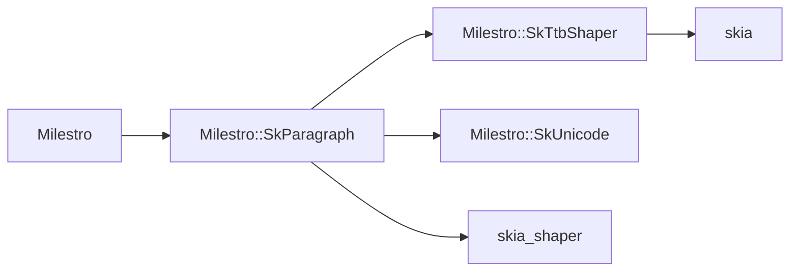

# Independent TTB shaping target

Status: the native `Milestro::SkTtbShaper` module is implemented and validated
on Windows x64 Debug. The refactored seven-target build succeeded and focused
CTest passed 7/7. Vertical paragraph layout, generated Unity bindings, and
Unity vertical-text behavior remain unimplemented.

## Problem

The TTB shaper must be usable by SkParagraph and by focused native tests without
depending on the `Milestro` DLL or its generated bindings. Keeping the
implementation in the main library would make a test executable link the main
library for one shaping function and would leave the future SkParagraph
dependency flowing in the wrong direction. Patching the pinned Skia checkout is
also unsuitable because vendor updates would overwrite the change.

## Directory and targets

The implementation is a project-maintained extension under `ext/skttbshaper/`,
parallel to `ext/skmodules/` and `ext/skia/`:

- `ext/skttbshaper/CMakeLists.txt`
- `ext/skttbshaper/include/skttbshaper/TtbShaper.h`
- `ext/skttbshaper/src/TtbShaper.cpp`
- `ext/skttbshaper/README.md`

It builds the static target `milestro_skttbshaper` and the alias
`Milestro::SkTtbShaper`. The public include is `skttbshaper/TtbShaper.h`, and
the namespace is `skia::textlayout`, matching the intended SkParagraph
consumer.

## Dependency graph



The new module has no edge back to `Milestro`, SkParagraph, SkUnicode, ICU,
Unity, or the generated bindings. Its HarfBuzz dependency is inherited through
the `skia` usage requirements. `ext/skttbshaper` is added after
`ext/skia-cmake` and before `ext/skmodules`. `ext/skmodules` fails
configuration if `Milestro::SkTtbShaper` is unavailable.

## Usage requirements and static symbols

`milestro_skttbshaper` exposes `cxx_std_20`, its own public include directory,
and the existing `skia` target's usage requirements. The HarfBuzz include path
is private to the module source. Linking `skia` reuses the HarfBuzz and SkShaper
static archives already produced by the pinned Skia build; the module does not
compile or copy a second HarfBuzz or SkShaper implementation.

The target is static and does not use `MILESTRO_API` or a DLL export macro.
Root position-independent-code and symbol-visibility settings apply as they do
to other static targets. `milestro_skparagraph` links `Milestro::SkTtbShaper` as
a private implementation dependency without exposing the TTB headers through
the SkParagraph public interface. For static libraries, CMake propagates that
dependency to the final linker as a link-only requirement. This makes the TTB
archive available to the linker, but a static linker extracts only the objects
needed for unresolved symbols. No production SkParagraph code calls
`ShapeTtbRun()` yet, so the current `Milestro` DLL is not asserted to contain
the TTB function or body. Do not add a whole-archive option or an artificial
production call to force extraction.

## Interface constraints

The migration preserves the existing single-run contract: one segmented,
font-resolved UTF-8 run; upright TTB or sideways shaping; run-local Skia
downward-positive coordinates; global UTF-8 byte clusters; shaped advances and
offsets; and unresolved-glyph accounting. The caller remains responsible for
paragraph segmentation, bidi resolution, fallback selection, line breaking,
placement transforms, caching policy, and Unity integration. No forwarding
header or compatibility symbol remains at the former `Milestro` paths.

## Migration steps

1. Move the header and implementation into the project-maintained extension.
2. Change the public include to `skttbshaper/TtbShaper.h` and the namespace to
   `skia::textlayout`.
3. Remove the implementation from `MILESTRO_CORE_FILE` and remove its
   HarfBuzz include path from the main library.
4. Add the static target before `ext/skmodules` and make SkParagraph depend on
   it privately.
5. Link shaping tests directly to `Milestro::SkTtbShaper`; keep the existing
   SkShaper direction probe with the Unicode fallback test group.

## Independent-link verification

`MilestroTest_SkiaVerticalTextFeasibility` links
`Milestro::SkTtbShaper` and `Milestro::SkUnicode`, but not `Milestro`,
`Milestro::SkParagraph`, or `skia_shaper`. The SkShaper direction probe moved to
`tests/skia/src/test_skshaper_direction.cpp` and remains in
`MilestroTest_SkiaUnicodeFallback`, where it uses the existing Milestro Unicode
provider. The vertical target contains 15 tests; the moved probe is the former
sixteenth test and remains present without weakened assertions.

The link and target graph can be inspected from the repository root with a
configured build directory:

```sh
ninja -C <build-dir> -t commands MilestroTest_SkiaVerticalTextFeasibility
ninja -C <build-dir> -t commands Milestro
```

The first command must not contain `Milestro.lib`, `libMilestro`, or
`CMakeFiles/Milestro.dir`. The second must show the `milestro_skttbshaper`
archive as a private static link-only requirement of SkParagraph; that evidence
does not imply the TTB object is extracted into the DLL. The focused target's
compile command must expose the new module header and the existing `skia`
includes, while the HarfBuzz include remains private.

## Validation scope

The validated run on Windows x64 Debug used a normal CMake build of the
vertical-text, Unicode fallback, variable-font, paragraph hit-test, Ruby, and
InputBox targets. It completed 573/573 steps. The focused test command was:

```sh
ctest --test-dir <build-dir> \
  -R '^MilestroTest_(Skia.*|Ruby|InputBox.*)$' --output-on-failure
```

Focused CTest passed 7/7 in 36.80 seconds; the independent vertical group took
3.60 seconds and contains 15 cases. The moved SkShaper direction probe remains
in the Unicode fallback group.

Link inspection confirmed:

- The vertical executable link contains `milestro_skttbshaper.lib`,
  `milestro_skunicode.lib`, and `harfbuzz.lib`, without the Milestro main
  library or paragraph library.
- SkParagraph compilation receives the new module include and does not receive
  the module's private HarfBuzz include.
- The final `Milestro` link contains the TTB archive. As described above, this
  does not claim extraction of the TTB object before a production SkParagraph
  call exists.
- `llvm-nm` confirms the new archive defines
  `skia::textlayout::ShapeTtbRun`; `llvm-readobj` shows the focused executable
  imports only Windows system and MSVC runtime libraries, not
  `libMilestro.dll`.

The validation environment is Windows x64 Debug. Android, iOS, macOS, Linux,
release optimization, cross-platform packaging, complete vertical paragraph
integration, and Unity vertical behavior are not validated or implemented.
